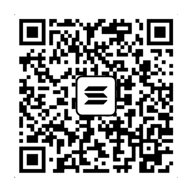

# Donate

Howdy, partner, and thank you so much for riding along. Just by downloading Pocket Box and giving it a spot in your saddlebag, you're already supporting the project.

Pocket Box is free, has no ads and never will. If you'd like to go a step further, a donation would greatly help me keep improving it: new features, fixes, and the long hours of testing on real phones that go with them. Every bit counts, and it's appreciated, never expected. Thank you very much in advance.

> **Before you send:** only use the addresses on this page, in the official repository [ButcheCassidy/PocketBox](https://github.com/ButcheCassidy/PocketBox). After pasting an address into your wallet, check that its first and last few characters match.

## Monero (XMR)


```text
43xJyzwfyeq5hgdVJrebGk7VwK2qFopTQDYzq18yd3BqZgEQdrNQcDv4wXESkkx3wJ8f2v99HZa8y7kLrW7bjrHqF1UJqUa
```

## Solana (SOL)



```text
EPV6Q8ZUvagTKCrhLTd1D7a5S6PS8emzsP6Tta9eD2D6
```

## USDC (on Solana)


```text
EPV6Q8ZUvagTKCrhLTd1D7a5S6PS8emzsP6Tta9eD2D6
```

Send USDC **on the Solana network only**. USDC sent from another network (Ethereum, Base, Polygon and so on) to this address will be lost.

## Free ways to help

- Star the repository, so others can find it.
- Report bugs with clear steps in [Issues](https://github.com/ButcheCassidy/PocketBox/issues).
- Tell a friend who keeps their music on their phone.

Pocket Box itself never goes online. Donating happens entirely in your own wallet app.

— ButcheCassidy - The Nomadic Rebel
